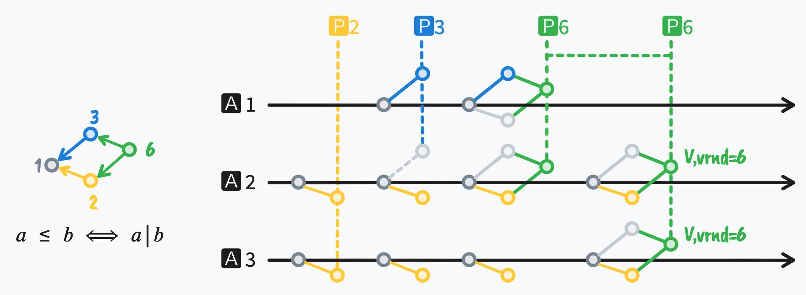

## Paxos: (Generalize): Partial Order Round Number = Paxos + 2PC

[Paxos](https://en.wikipedia.org/wiki/Paxos_(computer_science)) phase-1 要求
Proposer 生产一个**整数** n 来作为 `rnd`.
实际上 `rnd` 的定义从整数推广到任意的 [偏序关系](https://en.wikipedia.org/wiki/Partially_ordered_set) 的值, 也同样能满足 Paxos 的正确性, 因为 Paxos 中主要只用到了 `rnd` 的**大小关系**的性质.

使用偏序 `rnd` 的 Paxos,
可以选择**强制的**冲突互斥(类似[2PC](https://en.wikipedia.org/wiki/Two-phase_commit_protocol))
或是**非强制的**冲突互斥(类似Paxos的活锁)来实现一致性协议的安全性要求.

例如选择 **整除** 的偏序关系实现 Paxos, 定义 `rnd` 为正整数,
大小关系定义: **为如果 a 整除 b, 那么 a 才小于 b**:
这时有: `1 < 2 < 6`, `1 < 3 < 6`, 但是 `2 ≮ 3`.
如下例子中, Proposer P2 完成 phase-1 后, P3 无法完成 phase-1, 因为 Acceptor A2 上 `3 ≯ 2`, 于是放弃 P3, 使用 P6 完成 phase-1, 进而再完成 phase-2, 完成一次commit.

**在应用上**, 偏序的 `rnd` 给 Paxos 等一致性算法提供了非常大的扩展空间,
它将一维的先后关系扩展到多维度的先后关系(类似多维的时间).

例如对一个存储系统可以设置 2 组 `rnd`:

- 一组 Proposer 只选择 2ⁿ 的 `rnd`, 希望执行事务A;
- 一组 Proposer 只选择 3ⁿ 的 `rnd`, 希望执行事务B;

于是这两组 Proposer 之间互斥, 保证了最多只有一个事务成功(两组之间不会产生 Paxos 中的活锁).
而组内多个 Proposer 之间又可以形成互备(不存在 2PC 中 Coordinator 宕机的问题).

但这两组也可能互相阻塞. 以上图为例: A1 已承诺 3, A2 已承诺 2, 此后 A3 宕机.
A1 拒绝所有 2ⁿ, A2 拒绝所有 3ⁿ, 虽然 A1 和 A2 构成多数派, 两组却都无法继续.

这时任一 Proposer 都可以像图中的 P6 一样恢复:
选一个形如 2ⁿ·3ᵐ 的 `rnd`, 使它是 quorum 中每个 Acceptor 已承诺的 `rnd` 的倍数, 这里用 6; 如果承诺已经涨到 4 和 9, 就用 36.
恢复的 Proposer 照常执行 Paxos: 如果 phase-1 返回了已接受的值, 就采用其中 `rnd` 最大的那个, 所以它提交的可能是另一组的事务.
这个最大的 `rnd` 总是存在: 值只会在完成了 phase-1 的 `rnd` 上被接受,
而两个这样的 `rnd` 的 quorum 必有一个共同的 Acceptor, 它承诺的 `rnd` 只增不减, 所以所有被接受的 `rnd` 两两可比.

恢复用的 `rnd` 可以同时大于两组的 `rnd`, 所以恢复阶段退回到 Paxos 的**非强制的**冲突互斥:
多个恢复的 Proposer 之间可能互相抢占, 只有一个恢复的 Proposer 单独运行足够久时才保证完成.
因此高可用依赖这个恢复机制, 而恢复阶段的活性与经典 Paxos 相同.

所以, **偏序 Paxos 可以提供 2PC 的事务互斥性, 也提供了 Paxos 的故障容忍, 可以将分布式DB(例如spanner) 中的 2PC + Paxos 的两层架构简化成一层**.
