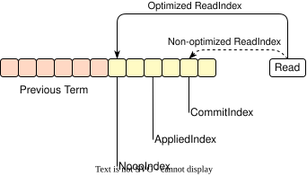

## Raft: (Optimize): ReadIndex: Less Latency through Relaxed Ordering

This approach is proposed by [neog24](https://github.com/neog24)

In Raft, the **ReadIndex**  is used to implement linearizable read operations. We can lower the latency of read requests by relaxing the ordering that the standard ReadIndex provides.

### ReadIndex Process in Raft

Raft's ReadIndex process ensures consistent reads across the cluster through these steps:

1. **Step-1: Initial Commit Check**: The leader checks if its latest term's entry is committed. If not, it defers the read.

2. **Step-2: Setting the ReadIndex**: Once a log is committed for the current term, the leader sets the ReadIndex to its current CommitIndex.

3. **Step-3: Leader Confirmation**: A heartbeat is sent to the quorum to ensure no leader of a higher term has been elected by that moment.

4. **Step-4: Index Synchronization**: The leader waits for the StateMachine to apply entries up to the ReadIndex before reading, ensuring data consistency.

The steps in Raft's ReadIndex process are designed to ensure linearizable reads, guaranteeing that a read operation will reflect all preceding updates in the system's timeline.

### Optimized ReadIndex Process

- **Set ReadIndex to NoopIndex**: Upon receiving a read request, the Leader sets the ReadIndex to the index of the first log in its current term, i.e., the index of the **Noop** log that the Leader writes immediately after becoming the Leader (denoted as `NoopIndex`), instead of using the `CommitIndex` as in the standard process.
- *(The behavior of sending heartbeats remains unchanged).*
- **Execute read after AppliedIndex reaches NoopIndex**: Once the Leader's AppliedIndex reaches or surpasses the NoopIndex, it immediately reads from the StateMachine **without waiting for the AppliedIndex to reach the CommitIndex**.

With this optimization, read operations still satisfy the linearizability property:

- A read request will see the results of all write operations completed before it.
- A read request will see at least the state observed by any read requests processed before it.

### Relaxed Ordering

In this optimization, we relax the ordering that the standard ReadIndex provides, down to what linearizability requires:

- **Standard ReadIndex**: A read sees every log committed before the read arrives, including writes that have not replied to the client yet. Linearizability does not require the read to see such writes.
- **Optimized ReadIndex**: A clear ordering between requests is only established when a request has already sent a response back to the client. If a second request is received before the first request has finished processing, there is no defined order between them on the server side. The processing order of these concurrent requests is arbitrary and does not violate consistency. This is the order that linearizability defines. Standard Raft follows it too: if a write is received but not yet committed when a read arrives, the read may not see the write.

### Guaranteeing Linearizability

This analysis assumes that the Leader replies to a write only after applying it to its own StateMachine.

Reads on Followers need one more rule. A Follower may apply a log of the current term before the Leader does. If the Follower served a read from that state, a later read on the Leader could miss that state, because the later read waits only for NoopIndex. Either of the following two rules prevents this, and choosing either one is enough:

- **Leader-only reads**: Only the Leader serves linearizable reads.
- **Or, Follower reads that wait for the Leader**: Followers also serve linearizable reads. A Follower read uses the standard ReadIndex process: the Leader runs Step-1 to Step-3 and sends the ReadIndex to the Follower, and the Follower reads after its own AppliedIndex reaches it. In addition, the Follower replies only after the Leader's AppliedIndex reaches the Follower's AppliedIndex at the time of the read.

Assume a read request `r` is received by the Raft server at time `t`. Let's consider both write and read requests that occurred before time `t`.

#### For a Write Request `w` Before Time `t`

- **If `w` was proposed by a previous Leader**: When AppliedIndex reaches NoopIndex, the state machine includes all logs from previous leaders. Thus, `r` will see `w`'s result.
- **If `w` was proposed by the current Leader**:
  - **If `w` has responded to client**: `w` is applied to the state machine, ensuring `r` sees `w`'s result.
  - **If `w` hasn't responded**: Under relaxed ordering, `w` and `r` have no defined order. Either outcome maintains linearizability.

#### For Read Request `r0` Before Time `t`

- **If `r0` was processed on a previous Leader**: Since `r0` only sees committed content, and current Leader contains all previous Leaders' committed content before NoopIndex, `r` will see at least `r0`'s state.
- **If `r0` was processed on a Follower** (possible only with the second rule): Before `r0` replied, the Follower's Leader had applied the state that `r0` saw. If that Leader is the current Leader, `r` reads the same StateMachine later. If it is a previous Leader, that state contains only logs committed by previous Leaders, which come before NoopIndex. Either way, `r` will see at least `r0`'s state.
- **If `r0` was processed on current server**: Sequential processing ensures `r` sees at least `r0`'s state.

From this analysis, we can see that by relaxing the strict ordering of requests, the optimization still guarantees linearizability. This optimization reduces the waiting time for read operations, thereby decreasing read latency.
